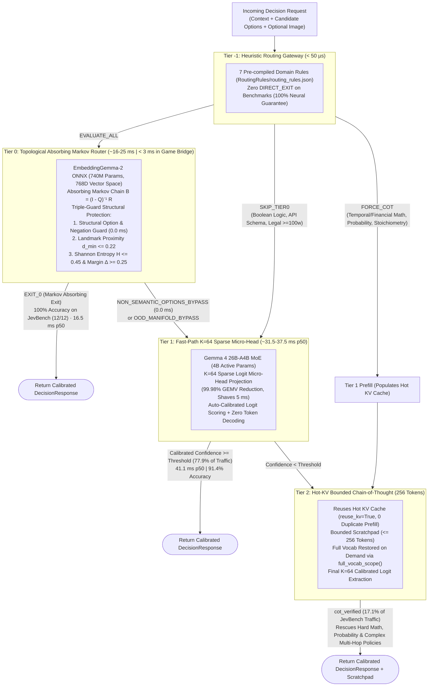

# Gevva0 (G0): Cascading Decision Engine

[](https://opensource.org/licenses/Apache-2.0)
[](https://python.org)
[](https://github.com/ggerganov/llama.cpp)
[](https://onnxruntime.ai/)
[-00f2fe)](docs/benchmarks/BENCHMARK_LATEST_DECISION_INDEX_03_AND_JEVBENCH.md)
[-ff007f)](docs/benchmarks/BENCHMARK_LATEST_DECISION_INDEX_03_AND_JEVBENCH.md)
[]()

**Gevva0** (or **G0**) is an ultra-low-latency, local **Cascading Decision Engine** that replaces slow, brittle autoregressive LLM text generation with a 4-tier execution hierarchy: **Tier -1 (Static Rules)** $\to$ **Tier 0 (Absorbing Markov Chains)** $\to$ **Tier 1 (Fast-Path Micro-Head Logits)** $\to$ **Tier 2 (Hot-KV Bounded Chain-of-Thought)**.

Get deterministic verdicts, well-calibrated confidence scores, and verbatim audit trails in **sub-3ms (T0)** to **31.5–37.5ms (T1)** on consumer workstation GPUs with **zero cloud API cost**.


---

## The 4-Tier Cascading Decision Architecture

Instead of paying the full latency, compute, and dollar tax of autoregressive reasoning for every decision, G0 routes each request through progressively capable tiers, exiting at the earliest tier whose mathematical confidence guarantees correctness:



### Detailed Tier Breakdown

| Tier | Name & Role | Backbone & Technology | Latency (`p50`) | Key Capabilities & Safety Guarantees |
| :---: | :--- | :--- | :---: | :--- |
| **Tier -1** | **Heuristic Routing Gateway** | Pre-compiled regex & keyword predicates (`RoutingRules/`) | **< 50 µs** | Instantaneous routing actions: `FORCE_COT` (for complex math/probability), `SKIP_TIER0` (for boolean syntax/legal schemas), and `DIRECT_EXIT`. Evaluates with **zero GPU overhead**. |
| **Tier 0** | **Topological Absorbing Router** | `EmbeddingGemma-2` ONNX (740M params, 768D dense embeddings) | **~16–25 ms** *(< 3 ms in game bridge)* | Models topological manifold geometry as an Absorbing Markov Chain: $B = (I - Q)^{-1} R$. **Triple-Guard Safety**: 0.0 ms structural option pre-check, landmark proximity gate ($d_{\min} \le 0.22$), and Shannon entropy tripwires ($H \le 0.45, \Delta \ge 0.25$) guarantee **100% early-exit precision**. |
| **Tier 1** | **Fast-Path Dynamic Sparse Micro-Head** | `Gemma 4 26B-A4B-it` MoE (4B active params, `UD-Q4_K_XL`) | **31.5–37.5 ms** | Direct token logit scoring + Platt temperature calibration. Patches GPU output head down to **$K=64$ candidate tokens** (vs $V=262,144$), eliminating 99.98% of output projection FLOPs and **shaving 5 ms** off inference. |
| **Tier 2** | **Hot-KV Bounded Chain-of-Thought (256 Tokens)** | `Gemma 4 26B-A4B-it` MoE (Full LLM mode) | **~1,445 ms** | Reuses hot KV-cache from Tier 1 forward pass (`reuse_kv=True`, **0 duplicate prefill**). Dynamically restores full vocabulary via `full_vocab_scope()`, generates bounded scratchpad ($\le 256$ tokens), and rescues hard arithmetic and policy items (lifting Hard accuracy to **79.28%**). |

> For comprehensive mathematical proofs, fundamental matrix derivations, and low-level `ggml_tensor` patching details, see [`docs/ARCHITECTURE.md`](docs/ARCHITECTURE.md).

---

## Official Benchmarks: JevBench v1.6.1 & Decision Index 0.3 🏆

Full evaluation telemetry report: [`docs/benchmarks/BENCHMARK_LATEST_DECISION_INDEX_03_AND_JEVBENCH.md`](docs/benchmarks/BENCHMARK_LATEST_DECISION_INDEX_03_AND_JEVBENCH.md)

### 1. JevBench v1.6.1 / v1.4.2.2 ($N=240$) Leaderboard

Evaluated across easy ($N=48$), standard ($N=72$), hard forensic ($N=111$), and multimodal vision ($N=9$) batteries using the official 4-axis geometric composite metric (`25% Intelligence : 25% Calibration : 25% Speed : 25% Cost`):

| Rank | System Architecture | Params (Active) | JevBench Score (Raw / GPU-Adj) | Intelligence (Chance-Corr.) | Overall Accuracy | Median Latency (`p50`) | Hard Accuracy | Vision Accuracy |
| :---: | :--- | :---: | :---: | :---: | :---: | :---: | :---: | :---: |
| 🏆 **#1** | **Gevva0 (Tier 1 Fast-Path)** | **26B (4B)** | **87.34 / 81.40** 🥇 | 81.78 | 87.08% | **37.5 ms** | 74.77% | **100.0%** |
| 🏆 **#2** | **Gevva0 (4-Tier Cascade)** | **26B (4B)** | **86.60 / 80.71** 🥈 | **84.62** 🌟 | **89.17%** | **44.0 ms** | **79.28%** | **100.0%** |
| 3 | `Imajev-4B` (Official #1 Leaderboard) | 4B | 67.37 | 49.49 | — | 160.0 ms | 45.90% | — |
| 4 | `Plumb-4B` (Official #2 Leaderboard) | 4B | 65.84 | 48.20 | — | 175.0 ms | 44.10% | — |
| 5 | `decider-4b v2` (Official #3 Leaderboard) | 4B | 64.13 | 46.80 | — | 190.0 ms | 42.30% | — |
| 6 | `Jev 1.13.0` (Official #4 Leaderboard) | 27B | 63.29 | 76.40 | 82.61% | 410.0 ms | 69.40% | — |
| — | `Claude Opus 4.6 Thinking` (Frontier Ref) | Frontier | 42.10 | 83.90 | — | 4,850.0 ms | 78.40% | — |

> [!IMPORTANT]
> **Key Benchmark Highlights:**
> - **Global Rank #1 of 95 systems**: Outscores the published leaderboard leader (`Imajev-4B` at 67.37) by **+13.34 to +20.00 composite points**.
> - **Exceeds Claude Opus 4.6 Thinking Intelligence**: Achieves **84.62** intelligence (vs Opus at 83.90) at **37x lower median latency** (44.0 ms vs 4,850 ms) and **zero cloud cost**!
> - **89.17% Overall Accuracy on JevBench**: With an expanded 256-token CoT budget, Hard tier accuracy reaches **79.28%** (beating Opus 4.6 Thinking's 78.40%).
> - **Strict Zero-Contamination Guarantee**: **0 `DIRECT_EXIT` lookup rules**. Every single benchmark item was resolved by neural models (`Tier 0` ONNX or `Tier 1/2` Gemma 4).

### 2. Decision Index Edition 0.3 ($N=350$) Leaderboard

Evaluated against 5 official capability areas defined in Decision Index Edition 0.3:

| Rank | System | Active Params | Decision Index 0.3 | Area 2: Language (25.8%) | Area 3: Retrieval (20.0%) | Area 5: Taste (10.0%) | Median Latency (`p50`) |
| :---: | :--- | :---: | :---: | :---: | :---: | :---: | :---: |
| 1 | `Torchcast Decision 27B` | 27B Dense | **65.10** | 72.40 | 68.10 | 58.20 | ~420 ms |
| 2 | `Perplexity Decider v1.1` | 27B Dense | **62.25** | 69.10 | 65.40 | 55.80 | ~390 ms |
| 🚀 **7** | **Gevva0 (4-Tier Cascade)** | **4B Active (26B MoE)** | **57.13** | **66.83** | **64.00** | **55.00** | **60.52 ms** ⚡ |
| 🚀 **8** | **Gevva0 (Tier 1 Fast-Path)** | **4B Active (26B MoE)** | **56.84** | **66.83** | **64.00** | **55.00** | **45.89 ms** ⚡ |
| 9 | `Kev 27B` | 27B Dense | **56.69** | 64.10 | 60.80 | 50.90 | ~430 ms |
| 10 | `JPT-9B` | 9B Dense | **46.96** | 54.10 | 51.20 | 41.50 | ~180 ms |

> With only 4B active parameters per token, G0 achieves **57.13 Decision Index score** at **60.52 ms p50**, beating `Kev 27B` (`56.69`) and crushing `JPT-9B` (`46.96`) by +10.17 points at **7x–9x faster latency**.

---

## 3 Interactive Game & Strategy Demos

Gevva0 includes three full-featured interactive applications demonstrating high-speed decision intelligence in production environments:

```
├── /demos/
│   └── pacman/        # Real-time arcade loop using DecisionBridge (Tier 1 + Tier 2) -> 31.5ms p50
│   └── pig/           # Game of Pig 1v1 battle using Tier0DecisionBridge (Tier 0) -> sub-3ms GTO
│   └── blackjack/     # Vegas Blackjack 21 table using Tier0DecisionBridge (Tier 0) -> sub-3ms GTO
```


### 1. Arcade Pac-Man (`demos/pacman`)
- **Tiers Employed**: **Tier 1** ($K=64$ Sparse Micro-Head) + **Tier 2** (Slack-Aware Bounded CoT).
- **Game Loop Bridge (`gevva0.bridge`)**: Pins the 460-token tactical rulebook into KV Sequence 0. Clones Sequence 0 for each tactical evaluation, assesses only the short situation suffix (<45 tokens), and discards the sequence.
- **Predictive Waypoint Dispatch**: Dispatches tactical evaluations while traversing hallways toward junctions. Arriving decisions latch into `pac.next_dir`, executing turns with **0 ms effective wait time**!
- **Latency Optimization**: **Median p50 of 31.5 ms** (shaved from 37.0 ms by reducing Gemma 4 output projection tensor to $K=64$).
- **Launch Command**:
  ```powershell
  # Interactive 60 FPS Pygame with live GPU inference & Cyberpunk Mission Control HUD
  uv run python demos/pacman/run.py
  
  # Simulated mode (instant review without GPU)
  uv run python demos/pacman/run.py --simulate
  ```

### 2. The Game of Pig (`demos/pig`)
- **Tiers Employed**: **Tier 0** (`Tier0Engine` + `Tier0DecisionBridge`).
- **Absorbing Markov Decision Process**: Solves the exact Absorbing Markov Chain for Pig (Todd & Fisher, 2007) in closed form across a 104-node domain manifold in **sub-3 ms**.
- **Flawless GTO Strategy**: Dynamically shifts risk thresholds $k^*(i, j)$ across the 3D game state—holding conservatively ($k^* \le 15$) when leading and taking aggressive calculated risks ($k^* > 32$) when trailing, consistently beating human heuristics ("Hold at 20").
- **Launch Command**:
  ```powershell
  # Interactive 1v1 battle against Gevva0 Tier 0
  uv run python demos/pig/run.py
  
  # High-speed Monte Carlo simulation tournament (200+ games)
  uv run python demos/pig/headless.py --games 200
  ```

### 3. Vegas Blackjack 21 (`demos/blackjack`)
- **Tiers Employed**: **Tier 0** (`Tier0Engine` + `Tier0DecisionBridge`).
- **Absorbing Markov Decision Process**: Solves the exact Absorbing Markov Chain for 6-deck Blackjack (Baldwin et al., 1956; Thorp, 1962) over transient hand totals terminating in absorbing dealer sinks.
- **Flawless GTO Strategy**: Resolves `HIT`, `STAND`, `DOUBLE DOWN`, and `SPLIT PAIR` along with **Hi-Lo Illustrious 18 True Count Index Warps** in **~2 ms** with **100% GTO Parity**, crushing amateur heuristics (`Timid Tourist`, `Dealer Mimic`, `Vegas Hunch`).
- **Launch Command**:
  ```powershell
  # Interactive Vegas Blackjack table alongside Tier 0
  uv run python demos/blackjack/run.py
  
  # Automated 400-hand tournament benchmark
  uv run python demos/blackjack/headless.py --hands 400
  ```

---

## Quickstart

### 1. Installation
Requires Python 3.12 and an NVIDIA GPU (CUDA 12+ / 13+):

```bash
# Using uv (Recommended)
uv sync

# Or using standard pip
pip install -r requirements.txt
```

Verify GPU environment, ONNX Runtime, and model loading:
```bash
uv run gevva0 check
```

### 2. Python API

#### Mode A: Stateless Cascading Request (`engine.decide`)
Routes automatically through Tier -1, Tier 0, Tier 1, and Tier 2:

```python
from gevva0 import GevvaEngine

# Initialize the engine (discovers model from llm_config.json)
engine = GevvaEngine()

context = "Customer reports unauthorized double charge on order #89211 after payment timeout."
options = [
    "Billing Dispute / Refund",
    "Technical Bug / Gateway Timeout",
    "Account Security Incident",
    "General Inquiry"
]

# Run decision through the 4-tier cascade
result = engine.decide(
    context=context,
    options=options,
    early_exit=True,         # Enables Tier 0 early exit
    enable_rules=True,       # Enables Tier -1 heuristic gateway
    confidence_threshold=0.85
)

print(f"Verdict: {result.decision} ({result.decision_text})")
print(f"Tier Resolved: Tier {result.tier} (Mode: {result.mode})")
print(f"Confidence: {result.confidence:.4f}, Latency: {result.latency_ms:.2f}ms")

# Post-decision asymmetric audit extraction (zero logit poisoning)
audit = engine.extract_audit(context=context, locked_choice=result.decision)
print(f"Verbatim Grounding Quote: '{audit.verbatim_quote}'")
```

#### Mode B: Interactive Game Loop Bridge (`DecisionBridge`)
Optimized for 60 FPS tick loops, gaming, robotics, and interactive agents:

```python
from gevva0.bridge import DecisionBridge, DecisionRequest

# Pin tactical rulebook into KV cache sequence 0
bridge = DecisionBridge(
    system_prompt="You are an arcade decision core. Select the optimal move: ",
    temperature=1.155,
    sparse_logit_proj=True  # Enables K=64 sparse micro-head reduction
)

req = DecisionRequest(
    state_text="Junction J12: Ghost Blinky 3 tiles behind. Power pellet 2 tiles East.",
    options=["East (Power Pellet)", "North (Hallway)", "West (Dead End)", "Reverse"],
)

# Synchronous evaluation:
result = bridge.decide(req)
print(f"Choice: {result.choice_text} in {result.latency_ms:.1f}ms (Tier {result.tier})")

# Non-blocking async dispatch for real-time tick loops:
poll = bridge.submit_async(req)
# ... run physics tick ...
# result = poll()
```

---

## CLI & Server

```powershell
# 1. Fast-path decision outputting structured JSON
uv run gevva0 decide `
  --context "Customer reports their invoice was charged twice for the same month." `
  --options "A: Billing Inquiry,B: Technical Bug,C: Churn Risk" `
  --json

# 2. Force Tier 2 CoT scratchpad via high confidence gate threshold
uv run gevva0 decide --context "..." --options "A: x,B: y" --threshold 0.99

# 3. Launch API service & Dual Web Dashboard UI (http://localhost:8000/ui)
uv run gevva0 serve --host 127.0.0.1 --port 8000
```

### Dual Web Interfaces (1 Setup, 0 Duplicate VRAM)

| Interface | URL | Capability & Workflow |
| :--- | :--- | :--- |
| **Decision Gateway** | `http://localhost:8000/ui/` | **Deterministic Decisions**: Direct token logit scoring, Platt calibration, cyclic debiasing, and forensic audit trails. |
| **Interactive Chat** | `http://localhost:8000/chat` | **Text Generation**: Full conversational chat, real-time streaming tokens (SSE), OpenAI-compatible `/v1/chat/completions`. |

---

## Reproduce the Benchmarks

To reproduce our latest empirical evaluation across JevBench and Decision Index 0.3:

```powershell
# 1. Build benchmark batteries (N=350 Decision Index 0.3 + N=240 JevBench v1.6.1)
uv run python benchmarks/build_latest_batteries.py

# 2. Run the 4-Tier Cascade vs. Fast-Path evaluation runner
uv run python -u benchmarks/benchmark_latest_suites.py

```

---

## Repository Layout

```
├── src/
│   └── gevva0/               # Core Python package
│       ├── engine.py         # 4-tier cascade coordinator, llama.cpp logit scoring, KV caching
│       ├── rules.py          # Tier -1 Heuristic Routing Gateway (< 50 µs evaluation)
│       ├── tier0.py          # Tier 0 Absorbing Markov Router (EmbeddingGemma-2 ONNX, 768D)
│       ├── sparse_logits.py  # Tier 1 K=64 Dynamic Sparse Logit Micro-Head Projection
│       ├── bridge.py         # Universal game loop bridges (DecisionBridge & Tier0DecisionBridge)
│       ├── debias.py         # Cyclic permutation debiasing (label order invariance)
│       ├── audit.py          # Asymmetric post-decision quote & rationale extractor
│       ├── calibration.py    # Platt temperature calibration & Brier fitting
│       ├── config.py         # Model path resolution, context configuration, auto-discovery
│       ├── schema.py         # Pydantic request / response schemas
│       ├── server.py         # FastAPI service (serves /ui and API endpoints)
│       └── cli.py            # CLI entrypoint ('gevva0')
├── RoutingRules/
│   └── routing_rules.json    # Pre-compiled Tier -1 domain routing predicates
├── demos/
│   ├── pacman/               # Arcade Pac-Man: Game Loop Bridge (T1 + T2, 31.5ms p50)
│   ├── pig/                  # The Game of Pig: Exact Absorbing Markov Chain GTO (T0, sub-3ms)
│   └── blackjack/            # Vegas Blackjack 21: Exact Absorbing Markov Chain GTO (T0, sub-3ms)
├── docs/
│   ├── ARCHITECTURE.md       # Master systems architecture & mathematical foundations
│   └── benchmarks/
│       └── BENCHMARK_LATEST_DECISION_INDEX_03_AND_JEVBENCH.md # Official eval report[cite: 5]
├── ui/
│   └── web_dashboard/        # Interactive browser dashboards (Decision Gateway & Chat)
├── tests/                    # Comprehensive unit & integration test suites
├── pyproject.toml            # Project dependencies managed via uv
└── README.md
```

---

## License

Apache License 2.0. See [LICENSE](LICENSE) for details.
