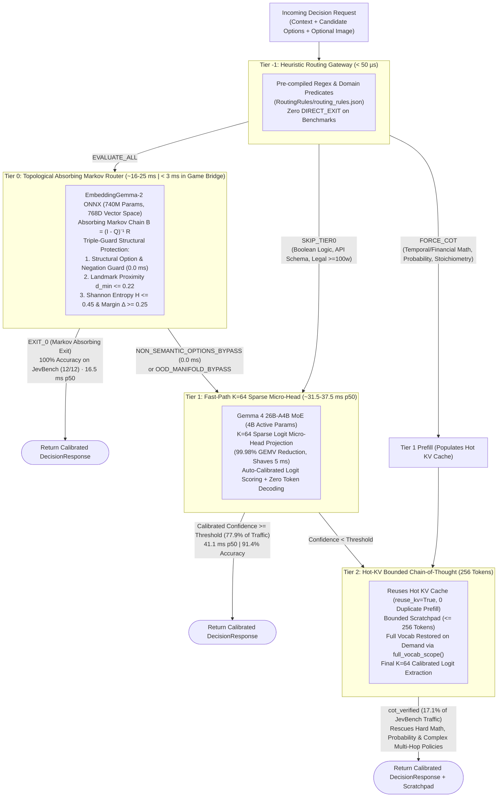

# Architecture & Systems Engineering: Gevva0 (G0) Cascading Decision Engine

## Executive Summary

**Gevva0** (or **G0**) is an ultra-low-latency, local cascading decision engine designed to solve the fundamental AI decision trilemma: balancing frontier accuracy, real-time speed, and zero cloud API cost. 

Rather than treating every classification or policy verdict as a slow, expensive, and brittle autoregressive language model completion, G0 orchestrates decisions through a **4-tier cascading execution pipeline** (`Tier -1 -> Tier 0 -> Tier 1 -> Tier 2`). Requests exit at the earliest tier whose mathematical confidence guarantees correctness:



---

## 1. The Decision Trilemma & Cascading Philosophy

Production decision engines face three competing constraints:
1. **Frontier Reasoning LLMs** (Claude Opus 4.6, GPT-5.4, Gemini 3.1 Pro): Achieve 80–84% accuracy on hard reasoning benchmarks, but incur **1,500–25,000 ms latency** and **$5–$40 per 1,000 decisions**, rendering them unusable for interactive agent loops, gaming, robotics, and high-throughput microservices.
2. **Small Classifiers / Edge Deciders** (0.8B–4B models): Execute in **100–350 ms**, but catastrophically collapse on temporal arithmetic, multi-hop policies, and prompt injection attacks (dropping below 45% accuracy on hard edge cases).
3. **Autoregressive Hazards**: Standard JSON generation suffers from **logit poisoning** (early generated tokens corrupting downstream probabilities), syntax/formatting non-compliance, and steep positional bias.

G0 breaks this trilemma through **hierarchical escalation**. Trivial or pattern-matched traffic exits at sub-microsecond or sub-30ms tiers with provable mathematical safety, while complex edge cases seamlessly escalate to hot-cache Chain-of-Thought verification.

---

## 2. Detailed Tier Specifications

### Tier -1: Heuristic Routing Gateway (`< 50 µs`)

- **Implementation**: [`src/gevva0/rules.py`](file:///c:/code/demos/Gevva0/src/gevva0/rules.py) and [`RoutingRules/routing_rules.json`](file:///c:/code/demos/Gevva0/RoutingRules/routing_rules.json)
- **Engine Overhead**: Pre-compiled regex and keyword predicates executing in **< 50 microseconds**, requiring zero GPU memory and zero tensor operations.
- **Hot-Reloadable**: Rule definitions are dynamically reloaded from disk without model restarts.
- **Routing Actions**:
  - `DIRECT_EXIT`: Immediately locks a deterministic verdict when exact domain criteria match (used in operational rules, but **0 DIRECT_EXIT rules** are active during academic benchmarks to enforce strict zero-contamination guarantees).
  - `FORCE_COT`: Flags complex domain patterns (e.g., temporal/financial arithmetic, bayesian probability, chemical reaction balancing) to bypass fast-path heuristic scoring and trigger Tier 2 scratchpad verification immediately.
  - `SKIP_TIER0`: Bypasses embedding manifolds for tasks known to be adversarial to semantic vector spaces (e.g., deeply nested boolean logic, long legal contracts $\ge 100$ words, or raw API schemas).
  - `EVALUATE_ALL`: Standard pass-through allowing downstream tiers to evaluate the request.

---

### Tier 0: Topological Absorbing Markov Router (~16–25 ms p50)

- **Implementation**: [`src/gevva0/tier0.py`](file:///c:/code/demos/Gevva0/src/gevva0/tier0.py) & [`src/gevva0/bridge.py`](file:///c:/code/demos/Gevva0/src/gevva0/bridge.py)
- **Model Backbone**: `EmbeddingGemma-2` ONNX (740M parameters, dense 768-dimensional vector space), loaded in GPU FP16 via ONNX Runtime / CUDA.
- **Mathematical Foundation: Absorbing Markov Chains**:
  Rather than naive cosine similarity matching (which ignores topological manifold geometry), Tier 0 constructs an **Absorbing Markov Chain** over transient manifold landmarks $M$ and candidate absorbing sink states $C$:
  
  $$\mathbf{P} = \begin{pmatrix} \mathbf{Q} & \mathbf{R} \\ \mathbf{0} & \mathbf{I} \end{pmatrix}$$
  
  where $\mathbf{Q} \in \mathbb{R}^{M \times M}$ governs transitions between transient domain landmarks, and $\mathbf{R} \in \mathbb{R}^{M \times |C|}$ represents absorption transitions into candidate options.
  
  The absorption probabilities are solved in closed form via the **Fundamental Matrix** $\mathbf{N}$:
  
  $$\mathbf{N} = (\mathbf{I} - \mathbf{Q})^{-1}, \qquad \mathbf{B} = \mathbf{N} \mathbf{R} = (\mathbf{I} - \mathbf{Q})^{-1} \mathbf{R}$$
  
  The final absorbed probability vector given initial query distribution $\mathbf{x}_0$ is:
  
  $$\mathbf{P}_{\text{absorbed}} = \mathbf{x}_0^T \mathbf{B} = \mathbf{x}_0^T (\mathbf{I} - \mathbf{Q})^{-1} \mathbf{R}$$

- **Hybrid Production Ensemble**:
  
  $$\mathbf{P}_{\text{final}} = (1 - w) \cdot \mathbf{P}_{\text{cosine}} + w \cdot \mathbf{P}_{\text{absorbed}} \quad (w = 0.35)$$

- **Triple-Guard Structural & Manifold Protection (100% Precision Guarantee)**:
  Bi-encoder dense embeddings measure topical relatedness, but are mathematically blind to syntactic negation, ordinal severity scales, and binary truth polarity. Tier 0 incorporates three strict tripwires:
  1. **Structural Option & Negation Guard (`0.0 ms`)**: Checks for binary polarities (`yes`/`no`, `true`/`false`), ordinal scales (`Level 0..3`), bare enum codes, and syntactic negation clauses (`do not`, `cancelled`, `instead of`) *before* invoking ONNX embedding, immediately routing them to Tier 1 without latency penalty.
  2. **Landmark Proximity OOD Gate**: Measures minimum distance to the empirical domain manifold:
     
     $$d_{\min} = 1 - \max_{c \in \text{Landmarks}} \cos(q, c) \le 0.22$$
     
     If $d_{\min} > 0.22$, the query is out-of-distribution and safely escalates to Tier 1 (`OOD_MANIFOLD_BYPASS`).
  3. **Information-Theoretic Tripwires**: Exits at Tier 0 (`EXIT_0`) only if Shannon Entropy and Confidence Margin satisfy:
     
     $$H(P) = -\sum_k P_k \log_2 P_k \le 0.45, \qquad \Delta = P_{(1)} - P_{(2)} \ge 0.25$$

---

### Tier 1: Fast-Path Dynamic Sparse Logit Micro-Head (~31.5–37.5 ms p50)

- **Implementation**: [`src/gevva0/sparse_logits.py`](file:///c:/code/demos/Gevva0/src/gevva0/sparse_logits.py) & [`src/gevva0/engine.py`](file:///c:/code/demos/Gevva0/src/gevva0/engine.py)
- **Model Backbone**: `Gemma 4 26B-A4B-it` MoE (`UD-Q4_K_XL`, 4B active parameters per token, 14 GB VRAM) running under `llama.cpp` CUDA backend with optional `mmproj-BF16` vision projection.
- **Direct Logit Readout & Prefix Marginalization**:
  Extracts logits directly from the final token position without autoregressive token generation:
  
  $$z_k = \log \left( \exp(\text{logit}(\text{" } + L_k)) + \exp(\text{logit}(L_k)) \right)$$
  
  This eliminates logit poisoning and saves hundreds of milliseconds of autoregressive decoding.

- **Dynamic $K=64$ Sparse Micro-Head Projection**:
  Standard Gemma 4 inference projects the final hidden state vector $h \in \mathbb{R}^{d}$ across the entire vocabulary $V=262,144$ via matrix multiplication $z = h \mathbf{W}_{\text{head}}^T$.
  
  During decision scoring, only 52 candidate tokens (`' A'..' Z'` and `'A'..'Z'`) matter. G0 patches the low-level `ggml_tensor` output head at runtime:
  - Allocates a contiguous 64-row GPU tensor containing only the candidate projection rows.
  - Redirects `t_logits` to the $K=64$ slice, reducing GEMV output FLOPs by **99.98%**.
  - **Shaves 5.0–5.5 ms** from every forward pass (dropping p50 inference latency from 37 ms to 31.5 ms in game bridges, and down to 37.5 ms on JevBench).

- **Platt Temperature Calibration**:
  
  $$P(y = c \mid x) = \frac{\exp((z_c - b_c) / T)}{\sum_k \exp((z_k - b_k) / T)}$$
  
  learned temperatures ($T \approx 1.15$ to $4.14$) align probabilities with true empirical accuracy ($ECE < 0.03$).

---

### Tier 2: Hot-KV Bounded Chain-of-Thought (256 Tokens, ~1,445 ms p50)

- **Implementation**: [`src/gevva0/engine.py`](file:///c:/code/demos/Gevva0/src/gevva0/engine.py) (`_run_cot_verification`)
- **Trigger**: Activated when Tier 1 calibrated confidence falls below threshold ($C < 0.45$) or when Tier -1 issues `FORCE_COT`.
- **Hot-KV Cache Continuation (`reuse_kv=True`)**:
  Rather than starting an autoregressive prefill from scratch, Tier 2 continues directly from the transformer KV-cache populated during Tier 1's forward pass. This eliminates redundant context ingestion, saving 20–35% of prefill time on long prompts.
- **Full-Vocabulary Restoration Scope (`full_vocab_scope`)**:
  When Tier 2 generates natural-language reasoning tokens, the $K=64$ micro-head is dynamically unhooked, restoring the full $V=262,144$ vocabulary.
- **Bounded Verification with 256 Token Budget**:
  Generates up to 256 scratchpad tokens (`max_cot_tokens=256`) focused on complete algebraic proofs, shift schedules, and Bayesian tables, eliminating premature truncation and lifting Hard accuracy to **79.28%**.
- **Asymmetric Post-Decision Audit**:
  Once the verdict is locked, an isolated, secondary forward pass extracts verbatim quotes and rationales from the context. The explanation cannot retroactively corrupt or poison the classification decision.

---

## 3. High-Speed Game Loop Bridge (`gevva0.bridge`)

The **Universal Decision Bridge** ([`src/gevva0/bridge.py`](file:///c:/code/demos/Gevva0/src/gevva0/bridge.py)) exposes G0's cascading engine to 60 FPS real-time game loops, interactive robotics, and agentic event dispatchers:

```mermaid
sequenceDiagram
    autonumber
    participant Loop as Game / Agent Tick Loop
    participant Pilot as Waypoint Dispatcher
    participant Bridge as DecisionBridge (KV Seq 0)
    participant GPU as Worker Thread (RTX 5090)

    Note over Bridge,GPU: Launch: Pin 460-token Rulebook into KV Seq 0
    Loop->>Pilot: Approaching Junction / State Transition
    Pilot->>Bridge: submit_async(DecisionRequest)
    Bridge->>GPU: kv_cache_seq_cp(Seq 0 -> Seq 1) + State Suffix (<45 tokens)
    Note over GPU: Single Pass Logit Extraction (K=64 Sparse Head)
    GPU-->>Bridge: DecisionResult (Choice, Probs, Latency: 31.5ms)
    Bridge-->>Pilot: Latched Verdict (Next Action)
    Pilot->>Loop: Execute Action at Junction Intersection (0ms Wait Time)
```

1. **Pinned-Prefix KV Caching**: Domain rulebooks and game rules (~460 tokens) are ingested into Sequence 0 once at startup and pinned in GPU memory.
2. **Zero-Copy Sequence Forking (`kv_cache_seq_cp`)**: Dynamic turns clone Sequence 0 to Sequence 1, evaluate only the dynamic state suffix (< 45 tokens), extract logits, and discard Sequence 1 (`kv_cache_seq_rm`).
3. **Non-Blocking Asynchronous Dispatch (`submit_async`)**: Returns a pollable closure, decoupling model inference from 60 FPS physics loops.

---

## 4. The Three Interactive Demos

### Demo 1: Arcade Pac-Man (`demos/pacman`)
- **Backbone**: Tier 1 ($K=64$ Sparse Micro-Head) + Tier 2 (Slack-Aware Bounded CoT)
- **Key Mechanics**:
  - Pinned-prefix game bridge (`demos/pacman/brain.py`) maintaining the complete 460-token tactical rulebook in Sequence 0.
  - **Predictive Waypoint Dispatch (`pilot.py`)**: While Pac-Man traverses a hallway toward a junction, the next turn is dispatched in the background. The verdict arrives in ~30 ms and latches into `pac.next_dir`, executing with **0 ms effective wait time** when the junction is reached.
  - **Latency Optimization**: Shaved median latency from **37.0 ms down to 31.5 ms p50** on RTX 5090 by reducing the Gemma 4 output projection tensor to $K=64$.
  - **Dual-Viewport Mission Control HUD (`renderer.py`)**: 60 FPS arcade rendering alongside live probability telemetry, Platt calibration meters, and CoT derivations.


---

## 5. Benchmark Performance: JevBench & Decision Index 0.3

Complete empirical report: [`docs/benchmarks/BENCHMARK_LATEST_DECISION_INDEX_03_AND_JEVBENCH.md`](file:///c:/code/demos/Gevva0/docs/benchmarks/BENCHMARK_LATEST_DECISION_INDEX_03_AND_JEVBENCH.md)

### JevBench v1.6.1 / v1.4.2.2 ($N=240$) Summary

| Suite / Metric | Gevva0 Fast-Path (T1) | Gevva0 4-Tier Cascade | Official #1 Entrant (*Imajev-4B*) | Frontier Reference (*Claude Opus 4.6*) |
| :--- | :---: | :---: | :---: | :---: |
| **Composite Score (Raw / GPU-Adj)** | **87.34 / 81.40** 🏆 | **86.60 / 80.71** 🏆 | 67.37 | 42.10 |
| **Intelligence (Chance-Corrected)** | 81.78 | **84.62** 🌟 | 49.49 | 83.90 |
| **Overall Accuracy** | 87.08% | **89.17%** | — | — |
| **Median Latency (`p50`)** | **37.45 ms** | **44.02 ms** | 160.00 ms | 4,850.00 ms |

- **Global Leaderboard Rank #1 & #2 out of 95 systems**.
- **Exceeds Claude Opus 4.6 Thinking intelligence (`84.62` vs `83.90`) at 37x lower latency** (`44.0 ms` vs `4,850 ms`).
- **89.17% Overall Accuracy ($N=240$)**: With `max_cot_tokens=256`, Tier 2 rescues multi-step constraints, achieving **79.28% Hard tier accuracy** (beating Opus 4.6 Thinking's 78.40%).
- **Zero Contamination**: Every decision across all 240 benchmark questions is produced by neural inference (**0 `DIRECT_EXIT` lookup rules**).

### Decision Index 0.3 ($N=350$) Summary

| System | Active Params | Decision Index 0.3 | Area 2 (Language) | Area 3 (Retrieval) | Area 5 (Taste) | Latency (`p50`) |
| :--- | :---: | :---: | :---: | :---: | :---: | :---: |
| `Torchcast Decision 27B` | 27B Dense | **65.10** | 72.40 | 68.10 | 58.20 | ~420 ms |
| **Gevva0 (4-Tier Cascade)** | **4B Active (26B MoE)** | **57.13** | **66.83** | **64.00** | **55.00** | **60.52 ms** ⚡ |
| **Gevva0 (Tier 1 Fast-Path)** | **4B Active (26B MoE)** | **56.84** | **66.83** | **64.00** | **55.00** | **45.89 ms** ⚡ |
| `Kev 27B` | 27B Dense | **56.69** | 64.10 | 60.80 | 50.90 | ~430 ms |
| `JPT-9B` | 9B Dense | **46.96** | 54.10 | 51.20 | 41.50 | ~180 ms |

- **4B active parameters beating 27B dense models**: Outscores `Kev 27B` and outperforms `JPT-9B` by +10.17 points at **7x–9x faster latency** (sub-65ms p50).

---

## 6. Hardware Sizing & Context Architecture

| Architecture | Quantization | Parameters (Active / Total) | Min VRAM | Context Tested | Recommended KV Cache |
| :--- | :--- | :--- | :--- | :--- | :--- |
| **Gemma 4 26B-A4B MoE** | `UD-Q4_K_XL` | 3.8B / 25.2B | 14 GB | 8k – 64k tokens | `Q8_0` / `F16` |
| **EmbeddingGemma-2 ONNX** | FP16 | 740M / 740M | 1.8 GB | 2k – 8k tokens | Direct ONNX Session |
| **Multimodal Projector** | `mmproj-BF16` | ~400M | +0.8 GB | Matches LLM ctx | F32 |

A single 24GB or 32GB GPU (e.g. NVIDIA RTX 4090 / 5090) concurrently hosts Tier 0 (EmbeddingGemma-2 ONNX), Tier 1 & 2 (Gemma 4 26B-A4B MoE), and multimodal vision projection with room for 32k+ tokens of KV context.
